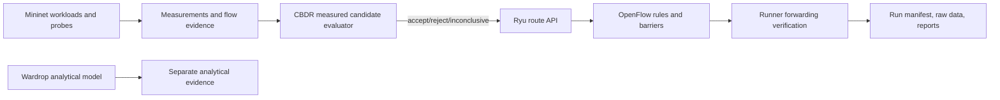

# MedRoute architecture and evidence boundaries

MedRoute is a deterministic research prototype. Its live path is Python runner → Ryu REST API → OpenFlow 1.3 rules on four OVS switches → Mininet hosts. `sdn/routes.json` contains baseline, shortcut, and recovery forwarding rules; `sdn/classes.json` drives the four queue-backed policy classes. `config/healthcare_qos.json` names six service profiles and maps them onto those existing four classes. The six labels do not imply six independently implemented queues.

The runner samples probes, iperf receivers, flow dumps, and port counters. It sends baseline and candidate measurements to the CBDR evaluator in `sdn/cbdr.py`. The current shortcut probe is aggregate path telemetry, so the live path evaluator has no per-class hard-constraint input. Class-specific constraint tests currently exercise the evaluator offline only.

The analytical Wardrop model in `src/model.js` is a separate model with route-choice equilibrium assumptions. Its output is never merged with Mininet evidence. A measured candidate degradation is reported as an observed harmful topology change; it is not labelled a formal Braess paradox without an equilibrium model for the measured network.

Controller success requires OpenFlow barrier replies from every currently connected required switch. The runner then checks mode/readiness and `ovs-ofctl` flow evidence. A barrier proves that the switch processed prior messages; it is not an end-to-end packet-delivery guarantee.

## Current evidence boundary

- Measured: probe RTT/jitter/loss, iperf throughput/loss, OpenFlow port counters, flow dumps, barrier confirmation.
- Derived: composite cost, percentile summaries, deadline miss counts, Jain index, and confidence intervals over recorded run-level values.
- Configurable assumptions: service objectives in the QoS files and the 5% candidate-cost threshold.
- Not currently collected: queue occupancy, validated clinical objectives, controller CPU/memory, multi-seed run-level performance, and independently measured per-service baseline-versus-candidate constraints.
